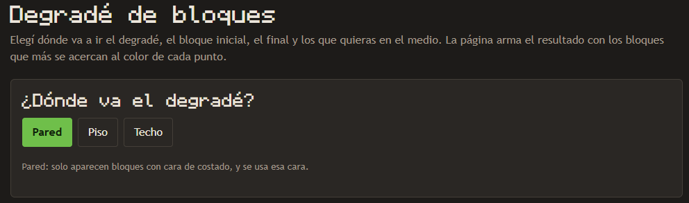
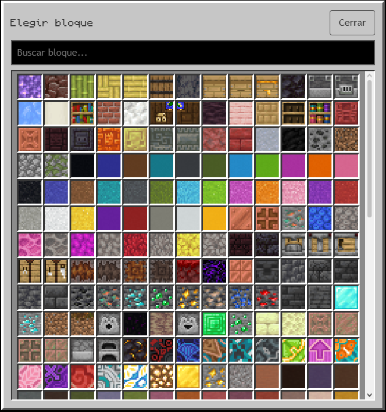
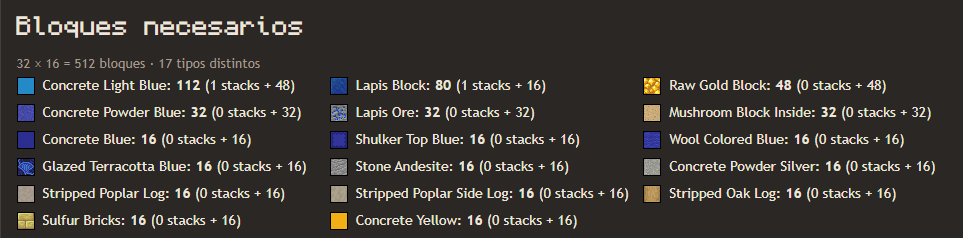
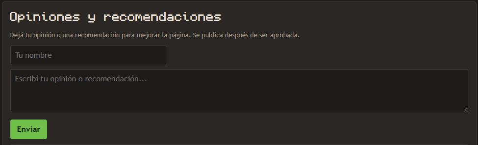
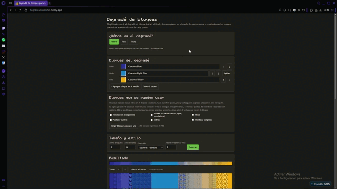
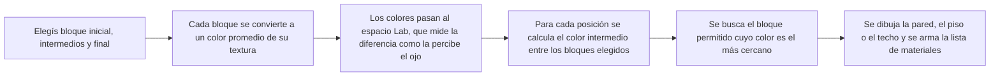
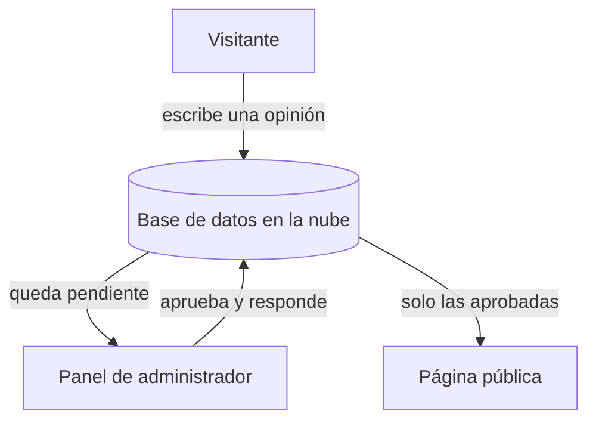

# Degradé de bloques para Minecraft Bedrock

Herramienta web gratuita para armar **degradés de bloques** de Minecraft Bedrock: elegís el bloque inicial, el final y los que quieras en el medio, y la página calcula qué bloques usar para paredes, pisos y techos.

**➡️ Probala en vivo: [degradesminecrfat.netlify.app](https://degradesminecrfat.netlify.app)**

> Este repositorio es una **vitrina del proyecto**: muestra qué hace y cómo funciona. El código fuente y los recursos no se publican acá.

---

## Qué hace

### Armá el degradé a tu manera
- **Bloque inicial, final y todos los intermedios que quieras**, para controlar la transición.
- **Orden editable:** subí o bajá cada bloque, o invertí todo el degradé con un click.
- **Selector de bloques estilo inventario de Minecraft**, con buscador. También se puede escribir el nombre.
- **Tamaño a medida:** hasta 200 × 200 bloques.
- **Cuatro direcciones:** horizontal, vertical, diagonal y radial (desde el centro).
- **Mezcla irregular:** un toque de azar para que la transición se vea más natural y menos en franjas.

### Pared, piso o techo
Cada superficie usa la **cara correcta del bloque**: el costado para paredes, la cara de arriba para pisos y la de abajo para techos.

### Solo bloques que sirven para construir
- Filtro automático que deja afuera flores y plantas, bloques que no se consiguen en supervivencia, bloques encendidos o activados con redstone, y todo lo que no es un bloque completo (puertas, antorchas, rieles, cofres, etc.).
- Grupos que se pueden activar o no (vidrios, hojas, texturas con transparencia).
- **Excluir bloques tocándolos** en el resultado: el degradé se regenera sin ellos, con opción de deshacer.
- Selección propia de bloques permitidos para cada superficie.

### Para planificar la obra
- **Lista de materiales** con la cantidad de cada bloque, en stacks.
- **Zoom** para ver cada bloque de cerca, incluso en paredes grandes.

### Portal de opiniones
Los visitantes pueden dejar su opinión o una recomendación, y el administrador las **aprueba y responde** desde un panel propio.

### Demo en movimiento

---

## Cómo funciona

La idea central es que **dos bloques que se ven parecidos tienen colores parecidos**, así que el problema se resuelve trabajando con color.

**Por qué el espacio Lab:** mezclar colores en RGB da transiciones que se ven raras. Lab está pensado para que la distancia entre dos colores se parezca a la diferencia que percibimos, y eso da degradés mucho más naturales.

**Por qué importa la cara del bloque:** un tronco tiene anillos arriba y corteza al costado, así que su color cambia según la superficie. Por eso la herramienta decide con qué cara comparar según sea pared, piso o techo.

### Arquitectura del portal de opiniones

Las opiniones **no se publican solas**: pasan por moderación. Las reglas de la base de datos permiten que cualquiera lea lo aprobado y envíe mensajes nuevos, pero solo el administrador puede aprobar, responder o borrar.

---

## Decisiones y problemas que resolví

- **Elegir qué cara usar de cada bloque.** Las texturas no dicen cuál es la de arriba o la de abajo, así que armé reglas por nombre de archivo y un editor para corregir los casos raros.
- **Separar lo que es un bloque de lo que no.** Un filtro automático descarta lo que no sirve para construir, con un modo de administrador para rescatar o esconder bloques puntuales.
- **Texturas animadas.** Las que vienen como tira de cuadros muestran solo el primer cuadro, en vez de verse aplastadas.
- **Moderación sin servidor propio.** El portal funciona con servicios gratuitos y reglas de seguridad, sin mantener un servidor.

## Tecnologías

- HTML, CSS y JavaScript, sin frameworks
- Firebase (base de datos y autenticación) para el portal de opiniones
- Netlify para el hosting
- Python para preparar la lista de bloques

## Créditos

- Tipografía de los títulos: [Monocraft](https://github.com/IdreesInc/Monocraft), de IdreesInc, con licencia OFL-1.1.
- Formas de los íconos basadas en [Feather Icons](https://feathericons.com) (licencia MIT).

## Aviso

Proyecto de fans, **no afiliado a Mojang ni a Microsoft**. Minecraft es una marca de Mojang Synergies AB. Este repositorio no incluye texturas ni recursos del juego.

## Contacto

Seguime en mi Instagram de MineCraft: [@minecraft_sin_shaders](https://www.instagram.com/minecraft_sin_shaders/)
Seguime en mi Instagram personal: [@matiaurelio](https://www.instagram.com/matiaurelio/)

---

© 2026 @matiaurelio. Todos los derechos reservados.
